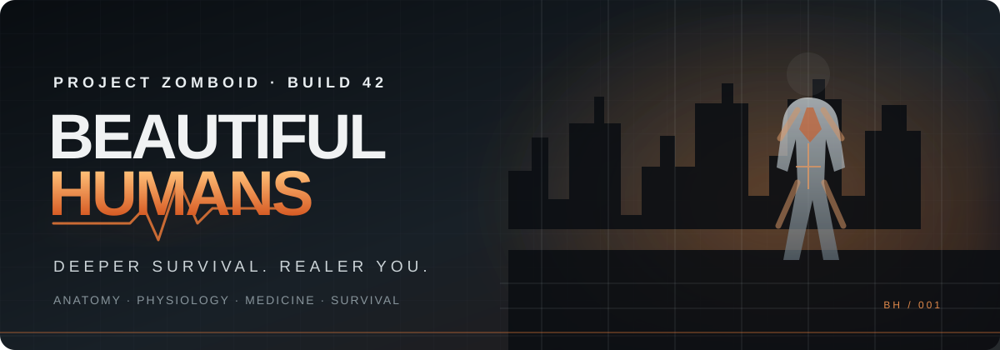
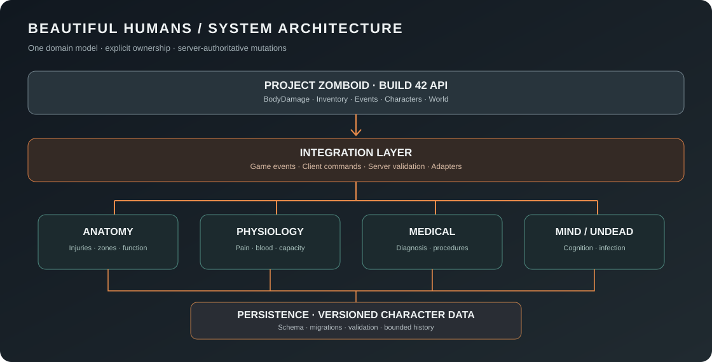
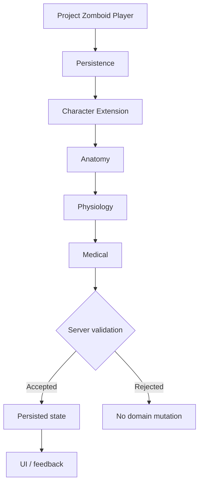

<p align="center">
  
</p>

<p align="center">
  <a href="https://github.com/hayferdahmer/BeautifulHumans/actions/workflows/validate.yml"></a>
  
  
  
  
</p>

<p align="center">
  <strong>Глубже выживание. Реальнее человек.</strong><br/>
  <sub>Анатомия · физиология · медицина · психика · заражение · общество</sub>
</p>

<p align="center">
  <a href="#vision">Концепция</a> · <a href="#systems">Системы</a> · <a href="#architecture">Архитектура</a> · <a href="#roadmap">Дорожная карта</a> · <a href="#development">Разработка</a> · <a href="#docs">Документация</a>
</p>

<p align="center"></p>

## О проекте

**Beautiful Humans (BH)** — долгосрочный проект глубокой переработки выживания в **Project Zomboid**. Его цель — сделать персонажа полноценной симуляционной системой: с анатомией, физиологией, травмами, лечением, психическим состоянием и последствиями решений.

Это не набор разрозненных механик и не косметический UI-мод. BH строится как модульная платформа, в которой системы используют общие данные, согласованные правила и единые контракты.

> Мир должен реагировать на состояние человека. Травма — менять возможности. Болезнь — развиваться. Решения — иметь цену. А производительность — оставаться предсказуемой даже в долгой многопользовательской игре.

<a id="vision"></a>

## Видение

<table>
  <tr>
    <td width="50%"><h3>🫀 Человек</h3>Анатомия, физиология, боль, кровопотеря, травмы, болезни, психика и восстановление.</td>
    <td width="50%"><h3>🧟 Угроза</h3>Заражение, поведение зомби, повреждения, адаптация и опасность окружающего мира.</td>
  </tr>
  <tr>
    <td><h3>🏚️ Среда</h3>Укрытия, поселения, безопасные зоны, строительство, предметы, ресурсы и транспорт.</td>
    <td><h3>👥 Общество</h3>NPC, фракции, профессии, отношения, торговля, экономика и конфликты.</td>
  </tr>
</table>

<p align="center"><sub>Это целевое направление проекта. Наличие системы в концепции не означает, что она уже реализована.</sub></p>

<a id="systems"></a>

## Системы проекта

Статусы отражают фактическое состояние разработки, а не обещания.

| Подсистема | Назначение | Статус |
|---|---|---|
| **Core** | Загрузка, модули, конфигурация, события, диагностика | 🟢 Foundation |
| **Persistence** | Данные персонажа, схема, миграции, восстановление | 🟢 Foundation |
| **Anatomy** | 17 зон тела, модель травм, функциональные ограничения | 🟢 Foundation |
| **Physiology** | Боль, кровопотеря, подвижность и возможности | 🟢 Foundation |
| **Medical** | Диагностика и медицинские процедуры | 🟠 Stage 2 |
| **Mind** | Стресс, страх, психика и когнитивные состояния | ⚪ Planned |
| **Undead** | Состояния, повреждения и поведение заражённых | ⚪ Planned |
| **Equipment / World** | Предметы, материалы, окружение и строительство | ⚪ Planned |
| **Society** | NPC, профессии, фракции и экономика | ⚪ Planned |
| **Wildlife** | Животные и экосистема | ⚪ Planned |

### Что уже заложено в кодовую базу

- Модульное ядро с направленными зависимостями и изоляцией ошибок.
- Версионируемые данные персонажа в `player:getModData()`.
- Миграции, проверка, ремонт и карантин повреждённых записей.
- 17 анатомических зон и структурированная модель травм.
- Несколько травм в одной зоне без молчаливой перезаписи.
- Физиологические последствия: боль, кровопотеря, mobility и manipulation.
- Каталог медицинских действий и базовые правила лечения.
- Внутренняя шина событий и runtime self-test.
- Headless-тесты, сборка и статическая проверка артефактов.

### Текущий этап

**Stage 2 — первая игровая вертикаль.** Базовая медицинская логика существует; в отдельном draft PR разрабатывается первый UI-срез и игровой поток лечения. Он ещё не принят в `main` и требует проверки в самой игре и мультиплеере.

<a id="architecture"></a>

## Архитектура

<p align="center"></p>

BH разделяет модель данных, доменные правила, интеграцию с игрой и представление. UI не должен самостоятельно рассчитывать медицинские показатели, а клиент не должен быть источником истины для критических изменений.

### Основные принципы

1. **Server-authoritative:** сервер подтверждает критические изменения состояния в мультиплеере.
2. **Single source of truth:** базовые игровые системы остаются владельцами своих исходных показателей.
3. **Модульность:** подсистемы имеют явные границы и направленные зависимости.
4. **Безопасные сохранения:** схема версионируется, данные ограничены и мигрируют.
5. **Измеряемая производительность:** никаких бесконтрольных обходов мира и тяжёлых операций каждый кадр.
6. **Проверяемость:** изменения сопровождаются тестами, проверкой сборки и ручными игровыми сценариями.

### Жизненный цикл данных персонажа



<a id="roadmap"></a>

## Дорожная карта

```mermaid
flowchart LR
    S0["0 · Технический аудит<br/>Завершён"] --> S1["1 · Core и инфраструктура<br/>В основном завершён"]
    S1 --> S2["2 · Первая игровая вертикаль<br/>В работе"]
    S2 --> S3["3 · Первая игровая версия"]
    S3 --> S4["4 · Инженерия и окружение"]
    S4 --> S5["5 · Экономика и поселения"]
    S5 --> S6["6 · NPC и общество"]
    S6 --> S7["7 · Транспорт и тактика"]
    S7 --> S8["8 · Животные и экосистема"]
    S8 --> S9["9 · Углубление симуляции"]
    S9 --> S10["10 · Стабилизация 1.0.0"]
```



Подробные критерии этапов и ограничения: [ROADMAP.md](docs/ROADMAP.md).

<a id="development"></a>

## Разработка

### Целевая среда

| Параметр | Значение |
|---|---|
| Игра | Project Zomboid |
| Проверенная сборка | **42.21.0** |
| Revision | `4a0e9546ec` |
| Steam buildid | `25485521` |
| Режимы | Singleplayer / Dedicated Server |
| Язык | Lua (Kahlua) |
| Инструменты | Node.js 22 · headless Lua harness |

Совместимость с другими сборками не предполагается без повторного аудита.

### Сборка

```bash
node tools/build.mjs
node tools/validate.mjs
```

### Тесты

```bash
npm install --prefix tools --no-audit --no-fund
node tools/run_tests.mjs
```

GitHub Actions выполняет тесты, собирает оба игровых артефакта и проверяет структуру релиза при каждом PR в `main`.

### Установка

До появления стабильного публичного релиза используйте инструкции из [PUBLISHING.md](docs/PUBLISHING.md) и тестовые сборки из CI. Не устанавливайте артефакты из незавершённых веток на основной игровой сервер.

<a id="docs"></a>

## Документация

| Документ | О чём |
|---|---|
| [Технический аудит](docs/TECHNICAL_AUDIT.md) | API Build 42, ограничения и подтверждённые возможности |
| [Архитектура](docs/ARCHITECTURE.md) | Слои, модули, зависимости и жизненный цикл |
| [Модель данных](docs/DATA_MODEL.md) | Структура персонажа и травм |
| [Модули](MODULES.md) | Каталог подсистем и их границы |
| [Сеть](docs/NETWORKING.md) | Серверная авторизация и сетевые контракты |
| [Производительность](docs/PERFORMANCE.md) | Бюджеты, ограничения и план профилирования |
| [Тестирование](docs/TESTING.md) | Автоматические и ручные проверки |
| [Дорожная карта](docs/ROADMAP.md) | Этапы 0–10 и критерии приёмки |
| [Changelog](CHANGELOG.md) | История заметных изменений |
| [Публикация](docs/PUBLISHING.md) | Сборка и выпуск |

<p align="center"></p>

## Принцип проекта

Beautiful Humans должен быть не просто большим модом. Он должен быть **согласованной, расширяемой и оптимизированной симуляцией**, где каждая новая механика усиливает остальные, а не создаёт очередной независимый набор скриптов.

<p align="center"><sub>BEAUTIFUL HUMANS · PROJECT ZOMBOID · DEEPER SURVIVAL. REALER YOU.</sub></p>
